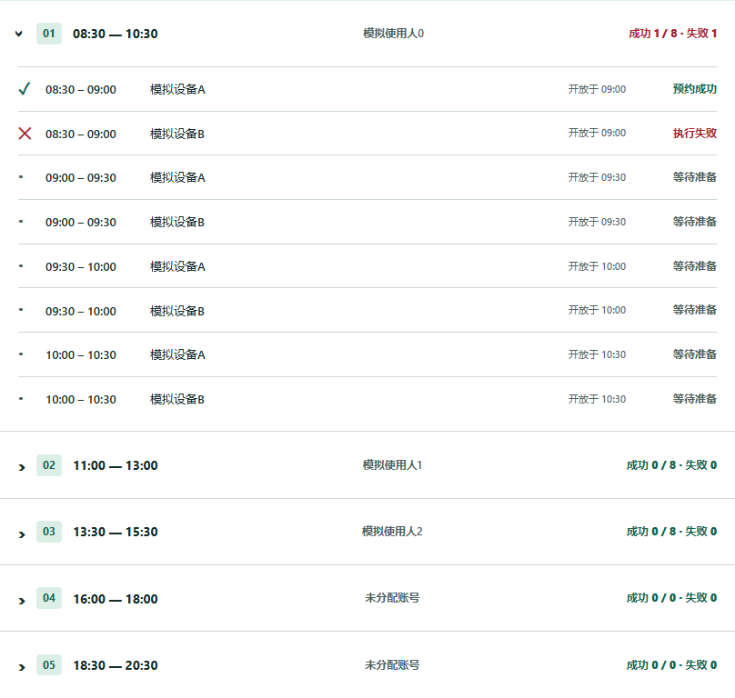

# CellStation

Windows 本地实验设备预约工作台。当前正式版：**1.0.7**。

[国内仓库](https://cnb.cool/mreasento/CellStation) · [下载正式版](https://github.com/MREASENTO/CellStation/releases/latest) · [微信通知教程](docs/wechat.md) · [开发与发布](docs/development.md)

## 开始使用

1. 下载 `CellStation-v1.0.7-win64.zip`，完整解压到可写短路径，例如 `F:\CellStation`。
2. 运行 `CellStation.exe`。运行环境、OCR模型随程序提供；电脑需安装 Google Chrome。
3. 在账号管理录入有权限的登录账号；在设置中按名称检索、添加设备，启用设备并调整顺序。
4. 勾选预约时间段，检查每日随机分配，也可随时手动调整。网站或登录暂时失败也可启动等待；实际任务准备时重新连接网站、登录并检查设备。
5. 保持电脑开机、联网、不休眠。关闭主窗口进入托盘；托盘退出才停止任务。

## 功能

- 五个可选预约窗口，每个分为四次半小时；按北京时间提前七天的对应结束时刻预约。
- 每日随机账号，支持重新随机和直接为时间段更换账号，运行时自动保存。
- 首页选择本人账号和设备直达预约日历；记录核对仍使用原账号。
- 网站预约周日历按颜色区分团队、非团队与待确认，可查看详情并直接添加团队人员。
- 团队人员无需账号密码；可按网站身份编号区分同名，并参与预约前重复核对。
- 自动处理未来七天尚未开始的已开放计划，提交前核对团队已有预约与保存记录。
- 多设备按优先顺序逐一预约全部启用设备；设备间记录和会话独立。
- 概览时间段可展开/收起，逐条显示成功、失败和等待状态；每日汇总倒序显示设备与时段。
- 启动调度只检查本地必要环境与配置；可选的网站/账号检测仅作提示，不发送微信。实际任务最终失败才按通知设置推送。
- 启动检查进度小窗，自检集中在设置；隐藏浏览器，不接管鼠标键盘。
- Windows失败提醒，Server酱Turbo及PushPlus微信通知；毫秒步骤时间、失败截图和诊断导出。
- CNB 国内 Git 增量更新，GitHub 备用；应用文件按差异拉取，运行环境变化时更新完整包；签名及逐文件SHA256验证，空闲安装、失败回退。
- 默认7天压缩、30天清理生成日志和截图，保留预约记录及诊断原因。

## 数据与更新

本地数据位于程序旁的 `data` 文件夹。账号及推送密钥由 Windows 当前用户加密；换电脑或用户时可能需要重新录入。搬移完整数据前请退出程序并复制整个便携目录。

自动更新只替换程序文件；正在执行预约或临近开放时推迟安装。网络源不可用时继续运行当前版本。默认国内加速为第三方公共服务，实际可用性由网络决定；设置支持自行部署的HTTPS清单镜像。更新清单必须使用本项目签名。

## 本次验证

本地逻辑测试、更新事务回退测试、Windows EXE启动及本地OCR、界面和便携包搬移验证均执行后发布；验证期间不提交真实预约。微信送达还需用户完成服务绑定并在设置发送测试消息。

开发说明包含完整构建和签名发布流程。

1.0.1及更早版本需先完整升级一次到1.0.7，之后使用Git更新通道。首次拉取会初始化应用代码缓存，后续只拉取新增Git对象。程序已内置MinGit，无需手动安装。

日期查看默认按北京时间当天＋7天自动翻页，跨天和休眠恢复后更新。手动选择其他日期时保留查看位置，可在日期旁恢复自动跟随。

1.0.7：需复核后立即查一次，首次未确认按可设置间隔再查一次；仍未确认停止自动复核。最终微信以【请自主复核】开头，和首次等待重查消息独立去重，明确要求使用者亲自核对。间隔支持运行中自动保存、调整正在等待的第二轮时间及备份恢复。
