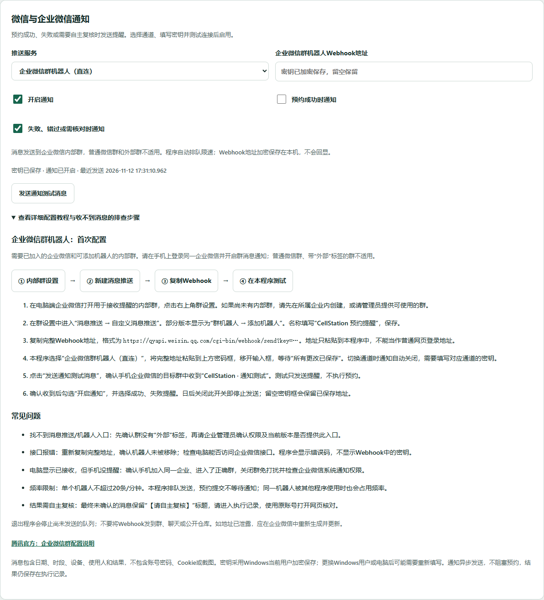

# 企业微信与微信通知配置

推荐通过**企业微信内部群机器人直连**接收预约提醒。CellStation 2.0.2 起支持，程序直接访问企业微信接口，不经 Server酱或 PushPlus。

## 1. 准备接收提醒的内部群

1. 在电脑和手机上登录同一企业微信账号，确认加入了正确企业。
2. 选一个用于预约提醒的**内部群**。没有内部群时，可在所属企业内创建，或请管理员提供可使用的群。
3. 群名旁若带“外部”标签，则不适用此功能；普通微信群也不适用。
4. 手机进入这个群，关闭免打扰；在系统设置中允许企业微信发送通知。

## 2. 创建消息推送机器人

在电脑企业微信中打开目标群，点击右上角群设置：

**群设置 → 消息推送 → 自定义消息推送 → 名称填写“CellStation 预约提醒” → 保存**

部分版本的入口名称为“群机器人 → 添加机器人”。如果找不到入口，先确认群类型，再请企业管理员检查权限及当前版本的功能入口。

创建后复制完整 Webhook 地址，其格式如下（省略号是示意，不可作为真实地址填写）：

`https://qyapi.weixin.qq.com/cgi-bin/webhook/send?key=…`

完整地址具有发送消息权限，只在本机设置框填写；不要发到聊天、公开仓库或截图中。若泄露，请在企业微信中更换机器人地址。

## 3. 在 CellStation 中保存和测试

1. 更新至 2.0.2 或更新版本，进入“程序设置”，滚动至下方“微信与企业微信通知”。
2. 推送服务选择“企业微信群机器人（直连）”。切换通道会默认关闭通知并清除旧通道在当前表单中的密钥，需要填写该通道的新密钥。
3. 粘贴**完整地址**到 Webhook 密码框，移开输入框，等待“所有更改已保存”。地址加密保存，框内随后清空，不代表保存失败；状态显示“密钥已保存”。
4. 点击“发送通知测试消息”。测试只发一条通知，不提交预约。
5. 确认手机目标群收到“CellStation · 通知测试”后，勾选“开启通知”，按需选择成功、失败提醒。修改后自动保存。
6. 后续留空地址框会保留已保存地址；关闭“开启通知”即可停止推送。

## 4. 通知与频率

- 每个成功或最终失败按原通知规则发送；需要你亲自确认的消息仍以“【请自主复核】”开头，与等待再次核对的消息区分。
- 消息包含目标日期、时间、设备、使用人和结果，不包含账号密码、Cookie或截图。
- 企业微信官方限制单个机器人每分钟不超过20条。本程序按请求至少间隔3.1秒排队，不阻塞预约；多个程序共用同一机器人时，也共同占用该频率。
- 长文本按UTF-8字节限制截断并附说明，关键日期、时间和结果优先放在正文前部。
- 队列尚未发完时推迟自动安装更新。主动退出程序会停止未发送的队列；关闭主窗口进入托盘仍会继续发送。
- 服务端确认接收不等于手机即时弹窗，收到测试消息后再启用正式提醒。

## 5. 排查

| 情况 | 处理 |
|---|---|
| 地址保存失败 | 复制完整HTTPS地址，确认域名为qyapi.weixin.qq.com，路径为/cgi-bin/webhook/send，包含key参数；不能只填key |
| 找不到机器人入口 | 确认不是外部群，请管理员核对群权限和企业微信版本 |
| 显示企业微信错误码 | 确认机器人未被移除、地址完整有效；频率过高时检查其他程序是否共用同一个机器人 |
| 电脑显示接收、手机没提醒 | 检查企业、群是否正确，群免打扰和手机系统通知权限 |
| 断网或超时 | 检查运行电脑能否访问qyapi.weixin.qq.com；预约结果仍保留在执行记录 |
| 换电脑后无法读取 | Windows加密绑定原用户，重新填写Webhook并测试 |

## 6. 其他通道

原 Server酱 Turbo 和 PushPlus 仍可使用，升级不会自动更改已有通道或发送真实测试消息。切换服务后重新填写对应密钥，再测试和启用。第三方服务的额度、认证费用以其官网为准。

参考：[腾讯官方群配置说明](https://cloud.tencent.com/document/product/248/50413)、[企业微信消息推送接口](https://developer.work.weixin.qq.com/document/path/99110)、[PushPlus额度](https://pushplus.plus/doc/guide/use.html)。
