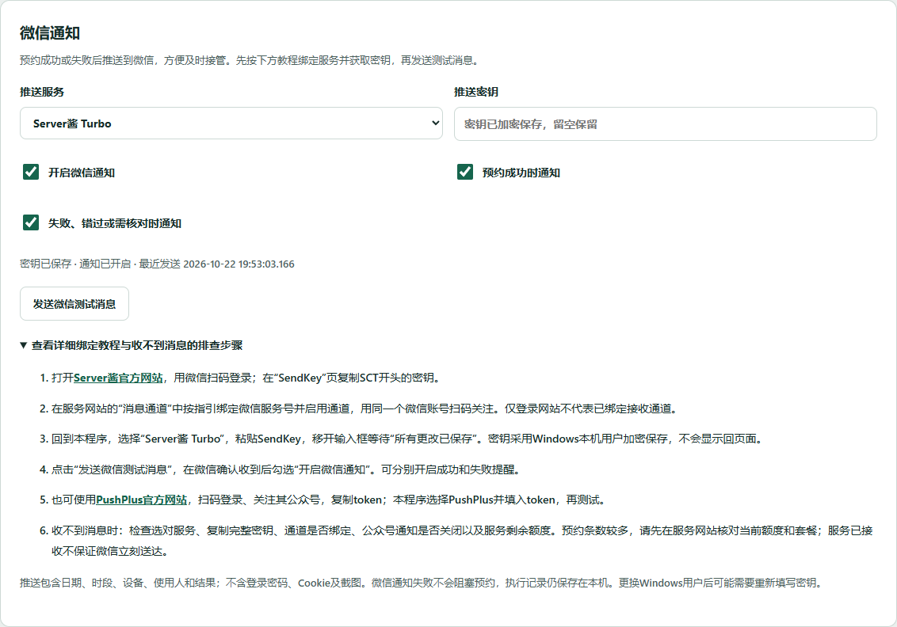

# 微信通知配置教程

1. 推荐使用Server酱Turbo：https://sct.ftqq.com/ 。在网站用微信扫码登录。
2. 进入SendKey页复制SCT开头的密钥。再进入消息通道设置，按服务网站指引绑定接收微信服务号，扫码关注并启用通道。仅登录网站不会自动完成通道绑定。
3. 回到“程序设置 → 微信通知”，选择Server酱Turbo，粘贴SendKey并移开输入框，等待“所有更改已保存”。密钥采用Windows当前用户DPAPI加密，不会回显。
4. 点击“发送微信测试消息”。在微信确认收到后，打开“开启微信通知”，选择成功、失败两种提醒。此测试只发送消息，不预约。
5. 也可用PushPlus：https://www.pushplus.plus/ 。扫码登录并按其指引关注公众号，复制token；程序选择PushPlus填入token并测试。
6. 若收不到：核对服务和密钥是否匹配；微信通道是否启用；是否关注接收公众号；公众号通知是否被关闭；服务额度是否用尽；电脑网络是否正常。服务返回已接收，不代表手机必然即时送达。
7. 每个设备每次成功或最终失败各触发一条通知，预约多时请先核对服务官网当日额度与套餐。消息包含设备、目标时段、使用人及结果，不包含登录密码、Cookie或截图。
8. 通知异步发送，不阻塞预约；失败信息显示在设置，预约结果保留在执行记录。更换Windows用户或电脑后可能需重填密钥。
官方教程：https://sct.ftqq.com/docs/getting-started/sendkey/ ，https://sct.ftqq.com/docs/getting-started/channels/ ，https://www.pushplus.plus/doc/guide/api.html 。实际通道和额度以服务网站为准。

